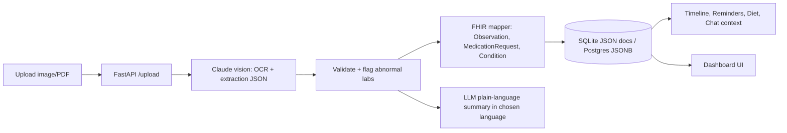

# Health Copilot — AI Personal Health Copilot (ABDM/FHIR aligned)

Upload prescriptions/lab reports → Claude vision extracts structured data → FHIR R4 bundle → plain-language summary
(Tamil/Hindi/Telugu…) → timeline, medicine reminders, diet plan, doctor finder, emergency home care, blood donor network, chatbot.

## Run
```bash
cd backend
python -m venv .venv && source .venv/bin/activate
pip install -r requirements.txt
cp ../.env.example .env   # add ANTHROPIC_API_KEY
uvicorn main:app --reload
# open http://localhost:8000
```

On Windows PowerShell, activate the virtual environment with:
```powershell
cd backend
.\.venv\Scripts\Activate.ps1
uvicorn main:app --reload
```

## Sign-in and app features

Create an account from the app. Passwords are stored as salted PBKDF2 hashes, and the API returns a short-lived bearer session; do not expose the development server to the public internet. The prototype does not yet include production-grade rate limiting, HTTPS deployment, account recovery, or regulated clinical authentication.

The app provides a searchable sample doctor directory, editable medicine/meal/hydration/activity reminders, a medicine-name list extracted from uploaded records, a pregnancy-care page with a general 40-week (10 approximate lunar-month) guide, food-safety and exercise education, record upload, FDA label lookup, first-aid education and emergency call links, specialist-doctor search, voluntary blood-donor preferences, and a general health-education chatbot. The chatbot can explain general, well-established information about a named medicine, including common uses, side effects, and important warnings; it cannot recommend a personal dose, confirm that a medicine is safe for a person, or replace a clinician or pharmacist. Check the medicine label for the exact product and country. Extracted tablet details may be inaccurate and must be checked against the original prescription; uploads do not automatically create medicine reminders or fill in missing schedules. Add a reminder only using clinician-provided instructions. The assistant is prompted not to prescribe, adjust doses, or claim interaction safety from incomplete records. Pregnancy content is educational, not individualized prenatal care; users should follow their clinician's advice. The app does not recommend pregnancy treatments, medicines, or doses. Pregnancy medicine reminders are only for user-entered instructions prescribed or approved by a clinician. Pregnancy food and movement information links to the NHS and ACOG; recommendations can vary by location and individual circumstances. Emergency guidance includes basic steps to follow while waiting for help; HEALTHIO does not dispatch a doctor or arrange a home visit. Contact local care providers directly for home visits and call emergency services for urgent or life-threatening symptoms. The interface supports English, Tamil, and Hindi; the selected language is remembered in the browser and is sent with account registration, uploads, and chat requests. AI-generated chat and document summaries use the selected language when the AI service is configured. Browser notifications require permission and the page to remain open. Medicine label lookup uses the public openFDA API. Claude document extraction and chat require `ANTHROPIC_API_KEY`; without it, documents are marked unprocessed and chat is unavailable. The app does not fabricate medical facts.

Pregnancy-care references:
- [NHS pregnancy week-by-week guide](https://www.nhs.uk/best-start-in-life/pregnancy/week-by-week-guide-to-pregnancy/)
- [NHS foods to avoid in pregnancy](https://www.nhs.uk/pregnancy/keeping-well/foods-to-avoid/)
- [ACOG exercise during pregnancy](https://www.acog.org/womens-health/faqs/exercise-during-pregnancy)

Doctor entries include seeded sample records and user-submitted listing details; none are independently verified by HEALTHIO. User-submitted listings do not include invented phone numbers. Confirm identity, credentials, affiliation, location, availability, and contact details with the provider or hospital before seeking care. The prototype has no verified blood-bank request integration and does not distribute donor contact details. Confirm all care and blood donation details with a licensed clinician, hospital, or blood bank.

## Pipeline


## Not production-ready (be honest in your demo)

This prototype has password hashing and bearer sessions, but does not have production-grade rate limiting, HTTPS deployment, password recovery, encryption at rest, ABDM consent artefacts, clinician review, or live push/SMS. ABHA IDs and the doctor directory are mock/sample data. Emergency dispatch and verified blood-bank request matching are intentionally unavailable; the UI directs users to emergency services and licensed blood banks instead of pretending an alert was delivered.
